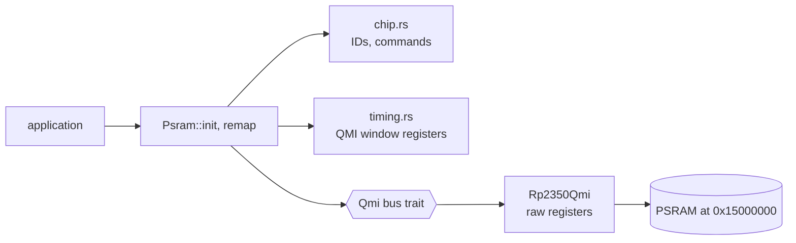

# qmi-psram

Driver for the ISSI IS66WVS16M8FBLL 16 MiB PSRAM in socket U24 of the MARV V2 Rev 1 flight controller (RP2354B), on the RP2350's second
QSPI chip select. The chip knowledge, the timing calculation and the start-up sequence are hardware-independent. The RP2350 back-end
(feature `rp2350`) uses raw registers, so it needs no HAL and works under embassy-rp, another HAL or none. The driver turns the PSRAM
into 16 MiB of ordinary memory.



## Usage

```rust
let p = embassy_rp::init(Default::default());
let (_qmi_cs1, _pin) = (p.QMI_CS1, p.PIN_0);              // keep both unused
// SAFETY: QMI CS1 and GPIO0 belong to the driver; core 1 is not running from flash.
let qmi = unsafe { qmi_psram::rp2350::Rp2350Qmi::new(qmi_psram::rp2350::Cs1Pin::Gpio0) };
let mut psram = qmi_psram::Psram::new(qmi);
psram.init(&mut embassy_time::Delay, embassy_rp::clocks::clk_sys_freq())?;
let memory: &mut [u8] = psram.as_mut_slice();             // 16 MiB
```

The application provides a `DelayNs` (embedded-hal 1.0), clk_sys in hertz and a `critical-section` implementation (for example
embassy-rp's `critical-section-impl`). Dependencies: `embedded-hal` 1.0, optionally `critical-section` and `defmt`.

## Docs

| Page | Contents |
|---|---|
| [docs/device.md](docs/device.md) | Chip commands, ID, timing limits, socket, QMI registers, pins, datasheets |
| [docs/driver.md](docs/driver.md) | Rules for correct use, chosen timing, features, reference throughput |
| [docs/testing.md](docs/testing.md) | Host tests and the on-board programs |

## Status

- Version 0.1.0. Host: `cargo test` passes; clippy, rustdoc and rustfmt are clean for the driver crate and every public item is documented.
- On the board: `psram_smoke` and `psram_soak` (60 s) pass on the Rev 1 board; all 16 MiB verified at 75 MHz, DMA both ways verified.
- Not done: an allocator on top of the memory; the other two parts the socket accepts (APS6404L, W25Q32); use while the second core runs
  from flash; a soak longer than the 60 s default.

Used by: MARV-FC firmware.

## MARV project

| Repository | Role |
|---|---|
| [MARV-FC](https://github.com/Lmx154/MARV-FC) | Flight-controller firmware for the MARV V2 board (RP2350B) |
| [MARV-GCS](https://github.com/Lmx154/MARV-GCS) | Ground station (`marv-gcs`) and command line (`marv-cli`) |
| [MARV-sim](https://github.com/Lmx154/MARV-sim) | Simulator that runs the firmware's flight code |
| Sensors | [icm45686](https://github.com/Lmx154/icm45686-rs) · [lsm6dsk320x](https://github.com/Lmx154/lsm6dsk320x-rs) · [bmp581](https://github.com/Lmx154/bmp581-rs) · [bmm350](https://github.com/Lmx154/bmm350-rs) · [sam-m10q](https://github.com/Lmx154/sam-m10q) · [adc-battery](https://github.com/Lmx154/adc-battery) |
| Board I/O | [pio-sdmmc](https://github.com/Lmx154/pio-sdmmc-rs) · **qmi-psram** · [ws2812c](https://github.com/Lmx154/ws2812c-rs) · [usb-cdc](https://github.com/Lmx154/usb-cdc) · [pio-uart](https://github.com/Lmx154/pio-uart) |
| Motors and links | [dshot](https://github.com/Lmx154/dshot-rs) · [esc-passthrough](https://github.com/Lmx154/esc-passthrough) · [rc-port](https://github.com/Lmx154/rc-port) · [crsf-codec](https://github.com/Lmx154/crsf-codec) · [mavlink-device](https://github.com/Lmx154/mavlink-device) · [marv-dialect](https://github.com/Lmx154/marv-dialect) |
| Other drivers | [lc76g](https://github.com/Lmx154/lc76g-rs) (Quectel LC76G GNSS) |

## Licence

MIT, see `LICENSE`. The driver is written from the datasheet listed in [docs/device.md](docs/device.md).
