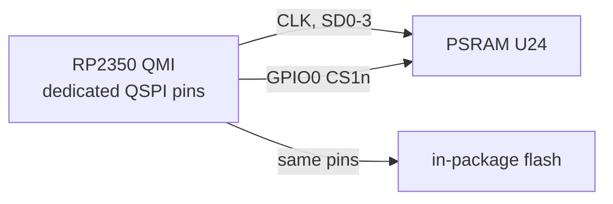

# IS66WVS16M8FBLL PSRAM device facts (MARV V2 Rev 1)

Part of [qmi-psram](../README.md)

The ISSI IS66WVS16M8FBLL is hand-fitted in socket U24 and reaches the RP2350 through QMI chip select 1. Page numbers refer to the PDF
pages of the datasheets at the end.

## Chip

| Item | Value |
|---|---|
| Supply, size | 2.7-3.6 V, 128 Mbit = 16 MiB, 24-bit address, two stacked 64 Mbit dies; a burst must not cross the die boundary; 1024-byte wrapped page |
| Power-up | SPI mode; wait at least 150 us. No reset recovery time is given; 150 us works, and the reset kept the contents (64 KiB checked) |
| Read ID (0x9F) | SPI, 24 address bits don't-care, no wait: manufacturer 0x9D, KGD 0x5D (0x55 = failed die), then a 48-bit EID whose top three bits give the density (100 = 128 Mbit) |
| CE# low limit tCEM | 4 us up to 85 degC; CE# high at least 1 clock; max clock 104 MHz |
| At 75 MHz | Read ID CE# low 1347 ns; window bursts end at 3.1 us with MAX_SELECT 7 (bound 3.85 us) |

| Command | Code | Notes |
|---|---|---|
| Reset-enable, reset | 0x66, 0x99 | must be consecutive |
| Read ID | 0x9F | |
| Read | 0x03 | 33 MHz in SPI mode |
| Fast read | 0x0B | 8 wait cycles SPI, 4 QPI |
| Quad IO read | 0xEB | 6 wait cycles, 104 MHz |
| Write | 0x02 | |
| Quad IO write | 0x38 | 0 wait, 104 MHz |
| Enter, exit QPI | 0x35, 0xF5 | |

Differences from the APS6404L that `embassy_rp::psram` targets: manufacturer ID 0x9D instead of 0x0D, 16 MiB instead of 8 MiB, 104 MHz
instead of 144 MHz, tCEM 4 us instead of 8 us, QPI fast read at 84 MHz.

Socket U24 is one SOIC-8 land for this PSRAM, an APS6404L-SQN-SN (8 MB QSPI PSRAM) or a W25Q32JVSNIQ (32 Mbit QSPI NOR); the PCB is
assembled with U24 empty.

## Driver settings at clk_sys 150 MHz

QPI, EBh read with 24 dummy bits, 38h write, CLKDIV 2 (75 MHz), RXDELAY 2, COOLDOWN 1, PAGEBREAK 1024, MAX_SELECT 7, MIN_DESELECT 2,
SELECT_SETUP 1. The RXDELAY pass window on this board is 1-4 at CLKDIV 2 and 0-5 at CLKDIV 3, so the default has one step of margin on
each side.

## RP2350 / RP2354B QMI

- Base 0x400d0000. Direct mode: set DIRECT_CSR.EN, wait BUSY low, assert CS1N, push to DIRECT_TX, always drain DIRECT_RX. XIP (the
  running program's flash) is inaccessible while direct mode is enabled, so that code must execute from RAM with interrupts off.
- Window 1 registers: RFMT/RCMD/WFMT/WCMD (datasheet p1236-1247). Writes through the window need CTRL.WRITABLE_M1.
- Window 1 is at 0x11000000 (cached) and 0x15000000 (uncached). Direct-mode FIFOs are faster via XIP_AUX 0x50500004/8 (p349). Cache
  clean by set/way: 0x1bffc001+8n (erratum E11).
- Programming the in-package flash resets the QMI configuration; `Psram::remap()` re-programs the window without a chip command.

## Pins

All GPIO are 3.3 V logic and not 5 V tolerant.

| GPIO | Net | Function | Notes |
|---|---|---|---|
| 0 | FLASH_CS1 | QMI CS1n | socket U24 chip select; 10k pull-up R35 |

Clock and SD0-3 are the MCU's dedicated QSPI pins shared with the in-package flash; supply V3V3_SYS; no pull-ups on SD2/SD3.

## Code

`src/chip.rs` (commands, `Id`, `Chip::IS66WVS16M8FBLL`), `src/timing.rs` (`Config`, `Timing::compute`, `WindowRegs`), `src/rp2350.rs`
(`Rp2350Qmi`, `CACHED_BASE`, `UNCACHED_BASE`).

## Related

- [driver](driver.md): how these facts are used
- [testing](testing.md): the on-board checks

## Datasheets

| Device | URL |
|---|---|
| RP2350 / RP2354B | https://datasheets.raspberrypi.com/rp2350/rp2350-datasheet.pdf |
| IS66WVS16M8FBLL PSRAM | https://cdn.sparkfun.com/assets/a/7/e/0/0/IS66WVS16M8FBLL-104NLI-COM-29556.pdf |
| APS6404L-SQN-SN PSRAM (socket option) | https://www.apmemory.com/tw/downloadFiles/0324112120g3605268 |
| W25Q32JVSNIQ NOR (socket option) | https://www.winbond.com/resource-files/W25Q32JV%20RevJ%2012242024%20Plus.pdf |
