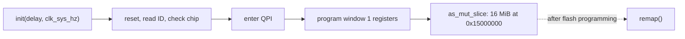

# Driver

Part of [qmi-psram](../README.md)

`Psram<Q>` runs the start-up sequence over a `Qmi` bus, computes the QMI window timing from clk_sys and hands the memory out as a
slice. The core is hardware-independent; `Rp2350Qmi` (feature `rp2350`) is the register back-end.

## Rules for correct use

| Rule | Why |
|---|---|
| `init` works whatever state the chip was left in and does not write to the memory | start from SPI or QPI |
| Call `init` before starting the second core | the flash the program runs from is unreachable for a few microseconds at a time while the driver talks to the chip; interrupts are off for about 8 us at a time |
| Call `remap()` after programming the in-package flash | that resets the RP2350's set-up for the PSRAM; the contents are kept |
| The memory is handed out at 0x15000000 (uncached) | the cached address 0x11000000 also works but writes through it are slower (7.9 against 20.8 MiB/s) |
| Compile this crate optimised in debug builds (`[profile.dev.package.qmi-psram] opt-level = 3`) | unoptimised, chip-select pulses last up to 13 us against the chip's 4 us limit (data checks still passed) |
| Timing comes from clk_sys: 75 MHz at 150 MHz | one step of sampling margin on each side on the reference board |

## Reference throughput

MARV V2 Rev 1, 75 MHz, CPU copies of 1 MiB sequential:

| Alias | Write | Read |
|---|---|---|
| Uncached 0x15000000 (handed out) | 20.8-21.0 MiB/s | 23.7-24.4 MiB/s |
| Cached 0x11000000 | 7.9 MiB/s (write-allocate) | 24.4-25.2 MiB/s |

DMA into the window runs at 31.2 MiB/s and out of it at 25.9 MiB/s (1.25 MiB each way, 0 mismatches).

## Cargo features

All off by default; without them the crate is hardware-independent `no_std`.

| Feature | Adds |
|---|---|
| `defmt` | `defmt::Format` for the public data and error types |
| `rp2350` | The raw-register RP2350 back-end; the application provides the `critical-section` implementation |

## Code

| File | Contents |
|---|---|
| `src/lib.rs` | `Psram`, `Info`, `Error` |
| `src/bus.rs` | The `Qmi` bus trait, `Width`, `BusError` |
| `src/chip.rs`, `src/timing.rs` | Chip data, timing calculation |
| `src/rp2350.rs` | The register back-end |
| `src/tests.rs` | Host tests |

## Related

- [device](device.md): chip and QMI facts behind the settings
- [testing](testing.md): how it is checked
