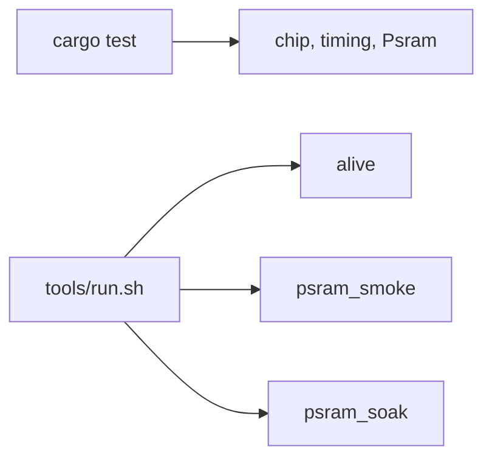

# Testing

Part of [qmi-psram](../README.md)

Chip data, the ID check and the timing calculation are tested on the host. The register back-end and the memory itself are checked by
three on-board programs in `hil/`, a separate package and workspace that is the only place using embassy-rp.



## Run

```text
cargo test                                   # host
tools/run.sh alive
tools/run.sh psram_smoke
SOAK_SECONDS=60 tools/run.sh psram_soak 180
```

`tools/run.sh` builds, flashes through a debug probe on the SWD header J10 and runs one program; it takes a lock so runs never overlap.
Needs Rust 1.99.1 with `thumbv8m.main-none-eabihf` and probe-rs 0.31.0. Exit status 0 means every check passed; logs go to `hil/logs/`.

| Program | What it checks |
|---|---|
| `alive` | Tool chain, probe and board |
| `psram_smoke` | Chip ID, start from either chip state, all 16 MiB written and read back twice, retention, chip against window, sampling margin, throughput, re-map, chip-select and interrupts-off times; never programs the flash |
| `psram_soak` | A control that the mismatch counter can count; DMA copies into and out of the window; then fill and verify of all 16 MiB with a new pattern every pass for `SOAK_SECONDS` (build-time, default 60) under a CPU and a DMA load; never programs the flash |

The 60 s soak runs about 17 passes of all 16 MiB with 0 mismatching words, including retention checks after a 3 s idle.

## Layout

```text
hil/src/lib.rs   reports the verdict to the host
hil/src/bin/     alive.rs, psram_smoke.rs, psram_soak.rs
hil/build.rs     links memory.x
tools/run.sh     build, flash, run
```

## Related

- [driver](driver.md): rules the programs exercise
- [device](device.md): the pins the test uses (QMI CS1 on GPIO0)
